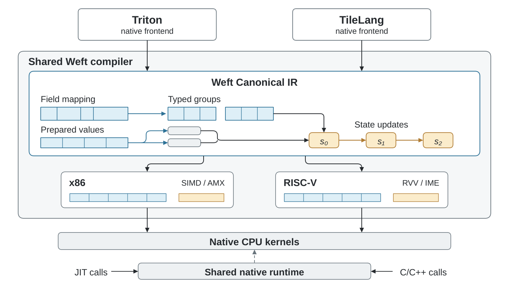

# TileLang–Weft

[中文](README.zh-CN.md) · [Handbook](https://tianchen-ai.github.io/tilelang-weft/) · [Examples](examples/weft/README.md) ·
[Upstream TileLang](https://github.com/tile-ai/tilelang)

**Native TileLang authoring with the Weft CPU programming model.**
This fork extends TileLang **v0.1.15** with Encoding, logical axes, Level,
state/stage, finite-width partials and per-contraction engine constraints.
It enters the same Canonical compiler and native runtime used by
[Triton–Weft](https://github.com/Tianchen-ai/triton-weft).



TileLang's native AST/Builder retains tile operations and model regions in TIRx.
An early importer constructs Weft Canonical IR. Shared physical passes select
layouts, local instructions, packing, schedules and resources.

## Write a kernel

```python
import tilelang
from tilelang.weft import language as T

@tilelang.jit(target="weft")
def add(N, block=128):
    @T.prim_func
    def main(X: T.Tensor((N,), "float32"),
             Y: T.Tensor((N,), "float32"),
             Z: T.Tensor((N,), "float32")):
        with T.Kernel(T.ceildiv(N, block), cpu_num_threads=4) as tile:
            for lane in T.Parallel(block):
                i = tile * block + lane
                if i < N:
                    Z[i] = X[i] + Y[i]
    return main

import torch
x, y = torch.randn(257), torch.randn(257)
z = torch.empty_like(x)
add(x.numel())(x, y, z)
torch.testing.assert_close(z, x + y)
```

Standard Tensor/StridedTensor, Parallel, serial control, copy/fill, GEMM,
reduction, macros, JIT and autotuning use TileLang's existing workflow.

## Express the implementation

| Author information | Compiler consumer |
|---|---|
| Encoding fields, bit layers, joins and derived layouts | Byte/bit addressing and local operand layouts |
| Logical axes and tile domains | Broadcast, projection and contraction relations |
| Level, initialized state and staged snapshots | Lifetime, reuse, carry and handoff analysis |
| Typed grouped partials and explicit casts | Legal finite-width instructions and accumulation |
| Local vector/matrix engine constraint | SIMD/RVV/VNNI or AMX/IME realization |
| Per-loop pipeline depth | Shared dependency scheduler and versioning expander |

The complete [Encoding/Level example](examples/weft/04_encoding_levels.py) computes
u4 × i8 products with explicit i16 groups and i32 widening.
[Persistent interleave](examples/weft/05_derived_layout.py) uses separate author
preparation and consumption programs.

The normal kernel library lives in [tilelang/weft/kernels](tilelang/weft/kernels):
activations, RMSNorm/LayerNorm, RoPE, blocked GEMM, online attention, Welford,
Top-K, MoE, selective scan, KV-cache updates, causal GQA, Q4_K/Q6_K programs,
Q8 activation preparation and codebook dequantizers using shared GGML schemas.
The [catalog](tilelang/weft/kernels/catalog.py) links names to their actual author programs.

## Install and run

Download matching `weft_core` and `tilelang` wheels from the
[project release](https://github.com/Tianchen-ai/tilelang-weft/releases/tag/v0.1.15-weft.2),
then install them in a Python environment:

```sh
python -m pip install ./weft_core-*.whl ./tilelang-*.whl
python examples/weft/01_pointwise.py
python examples/weft/02_tiles.py
python examples/weft/03_dynamic.py
python examples/weft/04_encoding_levels.py
python examples/weft/05_derived_layout.py
```

The distribution remains `tilelang`, with downstream identity `0.1.15+weft.2`.
The `weft-core` package supplies the shared native compiler/runtime and Clang 23
resources. Release assets name their Python ABI and host architecture. See the [handbook](docs/weft/index.md) for source builds, target/core
selection, autotuning, native export and C/C++ deployment.

For example, after selecting execution cores, `target="weft"` discovers their
actual capabilities; `T.gemm(..., engine="matrix")` requires a legal matrix
realization. The same source construction enters RVV/IME or x86 SIMD/AMX passes.
See [native deployment](examples/weft/README.md) for a complete Python export and
C++ application that loads the generated library.
The [GGML deployment example](docs/weft/native-deployment.md) also builds packed-row
packages and checks the actual native replacement calls against GGML.

## Experiments

**Under evaluation / 测试中.** Measurements use the independent
[Triton–Weft Bench](https://github.com/Tianchen-ai/triton-weft-bench).
The [TileLang adapter guide](https://github.com/Tianchen-ai/triton-weft-bench/blob/codex/tilelang-weft/docs/tilelang-weft-integration.md)
uses the Bench wheel included with this release.
Native computation, grid launch, Python/JIT calls and model stages have separate
timing boundaries.

## Source and upstream

This fork retains [TileLang](https://github.com/tile-ai/tilelang)'s upstream
history and pinned TVM dependencies. Extensions live under `tilelang/weft` and
`src/weft`; focused frontend/backend/JIT seams are documented
[here](docs/weft/upstream.md).

Shared core source has one owner:
[triton-weft/third_party/weft](https://github.com/Tianchen-ai/triton-weft/tree/codex/tilelang-weft-core/third_party/weft).
Each frontend owns its parser, JIT, cache and tuner, and calls the opaque shared
compiler ABI. Native applications need only the runtime and compiled artifact.

TileLang retains its [MIT license](LICENSE). Weft core uses Apache-2.0; bundled
dependencies retain their own notices.
