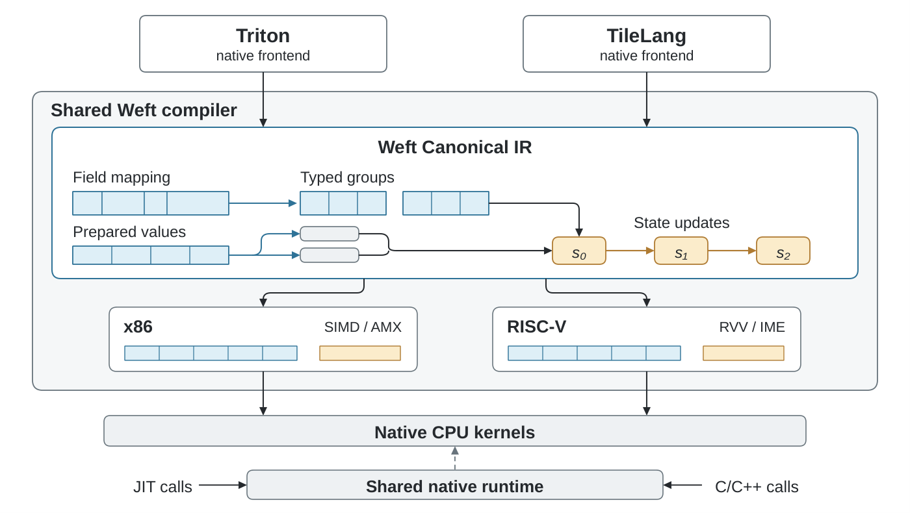
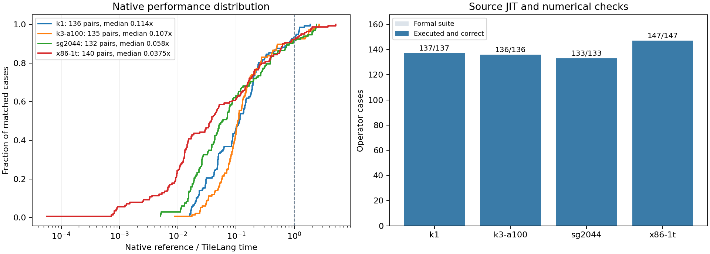

# TileLang–Weft

[English](README.md) | [双语手册](https://tianchen-ai.github.io/tilelang-weft/index.zh-CN.html) | [示例](examples/weft/README.zh-CN.md) | [Gitee 镜像](https://gitee.com/dongshan-community/tilelang-weft)

TileLang–Weft 是基于 **TileLang v0.1.15** 的 CPU 编译扩展。作者使用原生 TileLang
的 Tensor、tile 操作、循环、macro、JIT 和 autotuner，并可用 Encoding、Level、
state/stage 与有限位宽分组运算表达数据布局、复用及数值组织。



```python
import tilelang
from tilelang.weft import language as T

@tilelang.jit(target="weft")
def add(N, block=128):
    @T.prim_func
    def main(X: T.Tensor((N,), "float32"),
             Y: T.Tensor((N,), "float32"),
             Z: T.Tensor((N,), "float32")):
        with T.Kernel(T.ceildiv(N, block), cpu_num_threads=4) as tile:
            for lane in T.Parallel(block):
                i = tile * block + lane
                if i < N:
                    Z[i] = X[i] + Y[i]
    return main

import torch
x, y = torch.randn(257), torch.randn(257)
z = torch.empty_like(x)
add(x.numel())(x, y, z)
torch.testing.assert_close(z, x + y)
```

共同的原生 TileLang AST/Builder 生成 TIRx。Weft 在 tile 操作展开前导入共享
Canonical IR，使用同一 `weft-core` 物理编译器和 native runtime：

```text
TileLang AST / Builder → TIRx → Weft Canonical
                                   ├─ RISC-V Physical → intrinsic C / local asm
                                   └─ x86 Physical   → LLVM IR
                                                ↓
                                  native artifact → CPU grid / C ABI
```

Triton–Weft 也在 Canonical 边界进入同一个 core。各前端保留自己的语法解析、
JIT、缓存和调优服务；core 负责物理布局、局部指令、流水与资源处理。

## 使用

从[项目 Release](https://github.com/Tianchen-ai/tilelang-weft/releases/tag/v0.1.15-weft.2)
下载与宿主架构和 Python ABI 匹配的 `weft-core` 和 `tilelang` wheel 后：

```sh
python -m pip install ./weft_core-*.whl ./tilelang-*.whl
python examples/weft/01_pointwise.py
python examples/weft/02_tiles.py
python examples/weft/03_dynamic.py
python examples/weft/04_encoding_levels.py
python examples/weft/05_derived_layout.py
```

发行包保留 `tilelang` 名称，下游版本标识为 `0.1.15+weft.2`。源码构建、工具链、
目标与核心选择见[安装手册](docs/weft/index.zh-CN.md#安装与构建)。

## 作者模型

- **Encoding / View**：记录位宽、字段、分组、bit layers、joined fields 与持久布局。
- **Level / state / stage**：保留初始化区域、共享读取快照、数值状态与 handoff。
- **typed partial**：作者决定分组大小及 widen/cast 边界，编译器据此选择合法机器实现。
- **局部 engine**：`T.gemm(..., engine="vector"|"matrix"|"auto")`。
- **物理流水**：`T.Pipelined(..., num_stages=0/1/2/3/4)` 进入共享 scheduler/expander。
- **部署**：同一编译产物可从 Python grid 或原生 C ABI 调用。

可复用作者程序位于 [`tilelang/weft/kernels`](tilelang/weft/kernels)，包括激活、
归一化、RoPE、分块 GEMM、在线 attention、Welford、Top-K、selective scan，
MoE、KV-cache 更新、causal GQA，以及使用共同 GGML Encoding 的 Q4_K/Q6_K、
Q8 preparation 和 codebook 解码程序。[catalog](tilelang/weft/kernels/catalog.py)
直接指向实际作者程序。逐 contraction 的 `engine` 约束交给同一核心，选择 RVV/IME 或
x86 SIMD/AMX 的合法物理实现。[部署例子](examples/weft/README.zh-CN.md)给出了完整的
Python 导出、C++ 编译和原生调用。
[GGML 部署示例](docs/weft/native-deployment.zh-CN.md)继续展示 packed-row package、
实际原生替换计数，以及与 GGML 的结果核验。

## 实验

性能测量通过独立的
[TileLang–Weft Bench](https://github.com/Tianchen-ai/tilelang-weft-bench) 进行。
150 个不同算子 ID 在 SG2044、K1、K3 A100 和 x86 上组成 553 个平台用例，
其中 543 项有匹配外部参考合同。候选通过执行机已安装的 TileLang 源码 JIT 运行；
原生计算、grid 启动、冷 JIT、缓存恢复和 Python 热调用分别记录。



| 平台 | JIT 与数值检查 | 匹配参考 | 快于参考 | 原生倍率中位数 |
|---|---:|---:|---:|---:|
| SG2044 | 133/133 | 132 | 11 | 0.0580× |
| K1 | 137/137 | 136 | 9 | 0.1143× |
| K3 A100 | 136/136 | 135 | 10 | 0.1074× |
| x86 | 147/147 | 140 | 11 | 0.0375× |
| **合计** | **553/553** | **543** | **41** | — |

图中包含全部 543 项匹配原生比较及 553 项数值检查结果。倍率为参考耗时除以
TileLang 耗时。归一化和 activation 量化已有快于参考的实现；当前作者程序中的
packed dot 与完整 projection 仍有显著性能差距。使用已发行的 TileLang–Weft、
TileLang–Weft Bench wheel 和工具书中的完整套件命令即可复现实验。

[双语 Bench 工具书](https://tianchen-ai.github.io/tilelang-weft-bench/) 提供配套
wheel、源码绑定、固定参考流程和全量套件命令。
[算子结果](https://tianchen-ai.github.io/tilelang-weft-bench/results.zh-CN.html)提供完整 CSV、
原始样本、数值检查范围、源码参数和实际实现差距。

GitHub 的分支和 tag 会在 push、发布 Release 后自动同步到
[Gitee 镜像](https://gitee.com/dongshan-community/tilelang-weft)。

## 源码与上游

本仓库保留 [tile-ai/tilelang](https://github.com/tile-ai/tilelang) 的历史；新增内容集中在
`tilelang/weft` 与 `src/weft`。共同前端、backend manifest、JIT/cache 和 profiler 的接缝
见[维护者说明](docs/weft/upstream.md)。共享 compiler/runtime 的唯一源码位于
[Triton–Weft](https://github.com/Tianchen-ai/triton-weft/tree/codex/tilelang-weft-core/third_party/weft)。
TileLang 保留 MIT 许可；共享 Weft core 使用 Apache-2.0，第三方声明随发行包提供。
