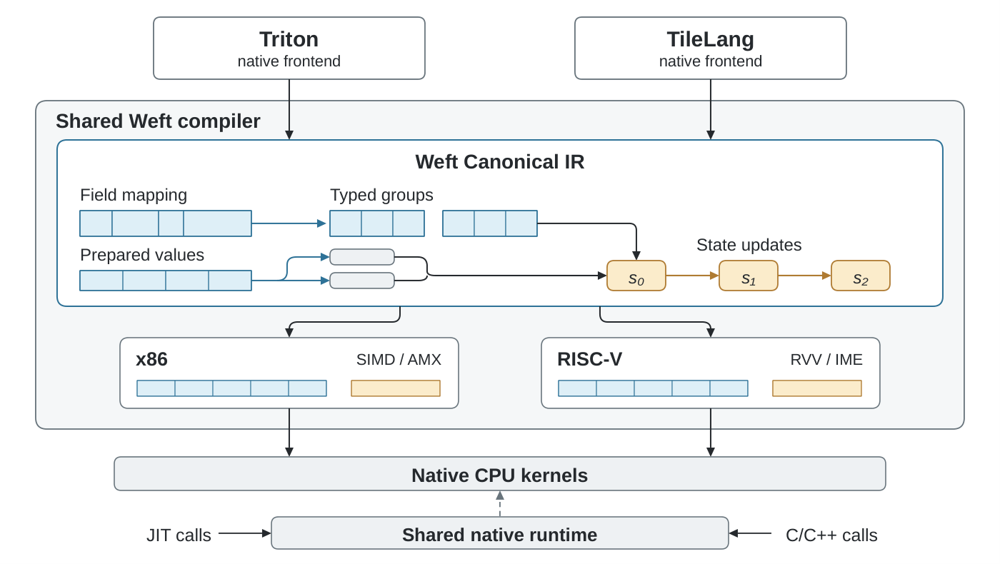
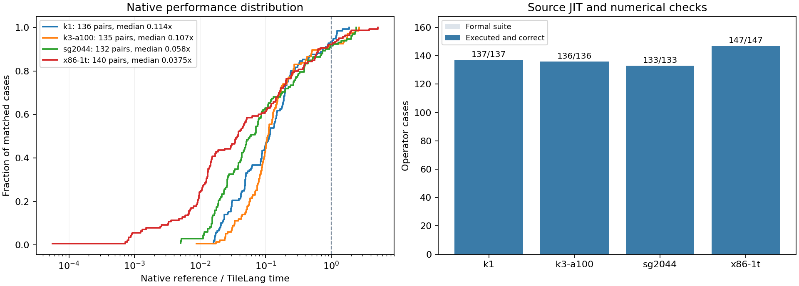

# TileLang–Weft handbook

[中文](index.zh-CN.md) · [Frontend seams](upstream.md) · [Runnable examples](https://github.com/Tianchen-ai/tilelang-weft/tree/main/examples/weft)

:::{toctree}
:hidden:

index.zh-CN
kernel-library
kernel-library.zh-CN
upstream
upstream.zh-CN
native-deployment
native-deployment.zh-CN
:::

TileLang–Weft embeds the shared Weft CPU compiler in TileLang v0.1.15.
The package version is `0.1.15+weft.2`; the import remains `tilelang`.



## Installation and builds

Download the matching host/Python wheels from the
[release](https://github.com/Tianchen-ai/tilelang-weft/releases/tag/v0.1.15-weft.2), then install them:

```sh
python -m pip install ./weft_core-*.whl ./tilelang-*.whl
python -c 'import tilelang, weft_core; print(tilelang.__version__, weft_core.__version__)'
```

The core wheel supplies its native compiler, runtime and Clang 23/OpenMP resources.
Its LLVM/MLIR ABI is private; TileLang keeps its matching TVM/TVM-FFI dependency.
CPU tensors are borrowed directly. Explicit `out_idx` outputs follow TileLang's
ordinary allocation convention.

Install a CPU PyTorch build for the host platform first. The RISC-V release also
provides native TVM-FFI dependency wheels for the supported Python ABIs. Download
the matching files into one directory and use `--find-links .` during installation:

```sh
python -m pip install --find-links . ./weft_core-*.whl ./tilelang-*.whl
```

On RISC-V, TVM-FFI uses PyTorch's DLPack protocol without requiring the optional
prebuilt `torch-c-dlpack-ext` distribution. Source dependency builds additionally
need Cython and setuptools-scm.

For source development, initialize the pinned submodules and build with the CPU
configuration. Install the matching `weft-core` wheel first. Use an environment
with the dependencies declared in `pyproject.toml` and CMake 3.26.1 or newer:

```sh
git submodule update --init --recursive
NO_VERSION_LABEL=1 CMAKE_ARGS='-DUSE_CUDA=OFF -DUSE_ROCM=OFF -DUSE_LLVM=OFF' \
  python -m pip wheel --no-build-isolation --no-deps . -w dist
```

An independently built core requires the LLVM/MLIR SDK selected by Triton–Weft.
`third_party/weft` is its standalone CMake and Python packaging root. Its
`WEFT_CLANG_ROOT`, `WEFT_OPENMP_LIBRARY` and `WEFT_OPENMP_INCLUDE_DIR` options bundle
the native C toolchain. Cross compilation additionally needs the declared target
sysroot and ABI.

## The author program

Use `from tilelang.weft import language as T` with `@tilelang.jit(target="weft")`.
Standard Tensor, StridedTensor, Parallel, serial, copy, fill, gemm, reduce and
scalar expressions retain TileLang's source construction. `T.Kernel` declares
independent CPU tile instances, and `cpu_num_threads` controls their native launch.

`T.reshape(buffer, shape)` creates a same-type, contiguous view of the same
storage. Reads and writes through either shape share one numerical value,
including updates carried through serial loops and helpers. A reshape keeps
the original allocation or state/stage lifetime. The
[tile example](https://github.com/Tianchen-ai/tilelang-weft/blob/main/examples/weft/02_tiles.py)
loads rows through a reshaped local tile before reducing them.

Fixed-width TIRx vector slices retain their lane domain through import.
Their Ramp indices become typed coordinates, and Broadcast shares the same
positional lane axis; saved buffer reads keep their original storage effects.
Local tile regions preserve this distinction too: a complete dimension is an
identity, a fixed element is an index, and only a selected coordinate domain
becomes a gather. `T.load(table, at=indices, bounds="in_bounds")` reads the
selected numeric elements from either a Tensor region or a saved value.

A saved encoded value can also be reshaped with explicit logical axes:
`T.reshape(record, (records, 32), axes=("record", "k"))`. This preserves the
original read snapshot and splits complete serialized records, so a scalar
field becomes one value per record and a payload field retains its lane axis.
It creates neither another read nor another state/stage declaration.

Encoding describes serialized storage. It does not implement dequantization:

```python
@tilelang.encoding
class Packed32:
    layout = (T.bitorder.lsb_first, T.byteorder.little)
    elements = 32
    alignment = 1
    q: T.Field("uint4", (32,)) @ T.grouped(elements=32) @ T.bit_layers(elements=16, order=T.lo_first)
```

Bind storage with `T.view(storage, shape=(M, K), encoding=Packed32, axes=("m", "k"))`.
Read a selected logical region with `T.load`; its fields are typed local tiles.
The shared GGML schema catalog is in `weft_core.formats.ggml`, with TileLang
declarations exposed by `tilelang.weft.kernels.ggml_formats`.

`T.stage(value)` produces a read-only snapshot for descendant reuse.
`T.state(shape, dtype, init=...)` creates numerical state. A Level retains separate
state initialization, staged initialization and body regions. Initializers see
incoming values, their own earlier declarations and the current point. Source
order does not allow an initializer to capture a sibling initializer or body value.

State initializers accept scalars and Tensor regions, including a saved
`T.load(...)` result. A saved encoded value supports the same logical selectors
as its View, so a descendant can select a staged record tile without reading
the original storage again. These projections retain the stage's lifetime.

`T.mac_groups(a, b, partial, n=4, into="int16", over="k")` retains the author's
partial grouping and width. Ordinary casts and reductions then build the rest
of the numerical program. See the complete
[Packed32 example](https://github.com/Tianchen-ai/tilelang-weft/blob/main/examples/weft/04_encoding_levels.py) and
[Q4_K/Q6_K programs](https://github.com/Tianchen-ai/tilelang-weft/blob/main/tilelang/weft/kernels/quantized.py).

For ordinary positional tiles, named contraction axes bind their trailing
dimensions: `over=("entry", "payload")` contracts both trailing dimensions.
Existing named View axes retain their identities. `T.mac_groups` keeps its
grouped axis last in the result, after the independent free axes of both
operands; an `(N, 4)` by `(M, 4)` quad product therefore writes `(N, M, 1)`
integer partials. The declared destination distinguishes independent matrix
axes from shared batch axes, including equal-sized dimensions.

## Layout, engines and scheduling

`T.gemm(a, b, c, engine="auto")` prefers a legal matrix realization, then vector.
Explicit `matrix` requires matrix hardware; explicit `vector` excludes it. The
constraint belongs to each contraction. Types and accumulation precision remain
unchanged. `T.reduce_dot(..., over=...)` contracts explicit named logical axes.

Persistent layouts use `@tilelang.derive`, `T.View[Encoding]` and `T.interleave`.
An author preparation kernel creates the stored bytes before the consuming
kernel. [Example 05](https://github.com/Tianchen-ai/tilelang-weft/blob/main/examples/weft/05_derived_layout.py) shows both programs.
Local machine packing remains a physical compiler decision within that program.

For an exported native entry, `T.view(..., abi=True)` declares the entry's logical
View contract. Its named dimensions remain runtime parameters, and the same
Encoding and access effects are written into the typed C ABI. Ordinary Tensor
programs continue to use pointer parameters and explicit in-function bindings.

`T.Pipelined(..., num_stages=0/1/2/3/4)` applies to one serial loop. The shared
scheduler selects legal stages and the shared expander creates versioned values
and buffers. DSL stage ownership remains separate from these physical stages.
Physical defaults are available through TileLang's existing pass configuration:

```python
@tilelang.jit(target="weft", pass_configs={"tl.weft.backend_options": {"pipeline_depth": 2}})
def factory(...):
    ...
```

Manual `order/stage` requests require complete operation and dependency coverage;
unsupported requests produce a source diagnostic.

## Targets and execution cores

`target="weft"` discovers the selected execution CPUs. For explicit compilation,
`tilelang.weft.target("sg2044")`, `"k1"`, `"k3-a100"`, `"k3-x100"`,
`"x86-avx2"`, `"x86-avx512"` and `"x86-amx"` construct target constraints.

Select a core group before the source JIT discovers its target:

```sh
python -m weft_core.cpu_cli --profile k3-a100 --cpus 8-15 application.py
```

The shared startup code performs K3 AI-thread registration before affinity.
Artifacts record their actual extension requirements; execution checks the worker
CPU set. Hardware resources are analyzed during physical compilation.

## JIT, cache and autotuning

Both lazy factories and eager annotated functions use TileLang's existing JIT.
Cache keys retain the native TIRx program, target, physical options, toolchain and
core identity. A disk cache hit restores a native artifact; a hot call launches
already loaded code. No Triton frontend is imported by this route.

`@tilelang.autotune` enumerates source/configuration choices and uses the CPU wall
timer. Trials use shared private storage preserving actual byte aliases and
readwrite state. Input restoration occurs outside the timed call. The selected
kernel executes once against the caller's actual inputs.

## Inspecting and deploying

`kernel.artifact.semantic_ir`, `.physical_ir` and `kernel.get_kernel_source()` expose
Canonical IR, selected target representation and generated C/LLVM IR.
`kernel.export_native(directory)` exports the same compiled native kernel, its
typed C header, target/runtime metadata and diagnostic sources.

An application loads that artifact through `weft-core`'s native runtime. It does
not parse TileLang source or link the compiler. A llama.cpp integration additionally
checks the exact GGML role, serialized layouts, argument order and worker boundary
before binding the native entry. Preparation and quantization costs remain part
of the explicitly selected application protocol.

The [autotune/export and standalone C++ example](https://github.com/Tianchen-ai/tilelang-weft/tree/main/examples/weft)
includes the actual compiler command and typed runtime loading. `T.extent(view, axis)` exposes
the accessible size of a tail View so authors can mask nonlinear consumers;
`T.narrow(value, dtype, rounding="rne", saturation=False)` records explicit narrowing.
Field Views such as `output[part].q` support typed writes, including packed Q8 preparation.
`T.load(table, at=indices, bounds="in_bounds")` reads a dense numeric View or
numeric field with an integer index tile. Indices address its row-major logical
table; the result retains the index tile's domain. Field projections retain
Encoding group relationships, including one sum per 16-element Q8_K group.

The same indexed load accepts a saved numeric tile, for example
`T.load(table, at=codes, bounds="in_bounds")` after `table = T.stage(T.load(view))`.
It looks up that snapshot, retaining its read epoch. Ordinary buffer indexing
continues to express a positional extraction.

`T.copy(value, output_view, annotations={"cache_hint": "streaming"})` carries the
author's store hint through Canonical IR. The x86 backend selects non-temporal
stores only for a legal aligned, disjoint write-only output. `"normal"` uses
ordinary cache policy. The hint changes neither numerical values nor ownership.

The optional `tilelang.weft.integrations.llama_cpp` module validates exported
artifacts against exact GGML roles before creating a native package. A kernel's
mathematical name alone does not determine its role: argument types, record layout,
shape dimensions, quantization and thread scope are checked by the shared integration.
See [native deployment](native-deployment.md) for a complete package, GGML call-site
build and replacement-counter example.

## Experiments

Comparative experiments use
[TileLang–Weft Bench](https://github.com/Tianchen-ai/tilelang-weft-bench).
Its formal suites contain 150 workload IDs and 553 platform cases, with 543
matched external reference contracts. Candidates run ordinary source JIT on the
execution machine. Native workloads, grid, cold JIT, cache restoration and Python
hot calls have separate columns.



The [operator results](https://tianchen-ai.github.io/tilelang-weft-bench/results.html)
publish the full CSV, original candidate/reference samples, hardware decisions
and source-level analysis. Use the Bench catalog to inspect each source variant,
Encoding provider, preparation protocol and counted work before reproducing it.
