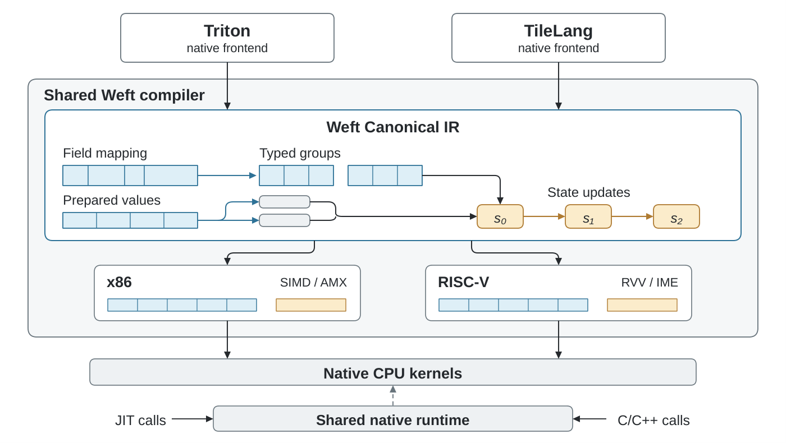

# TileLang–Weft 工具书

[English](index.md) · [上游接缝](upstream.zh-CN.md) · [可运行示例](https://github.com/Tianchen-ai/tilelang-weft/blob/main/examples/weft/README.zh-CN.md)

TileLang–Weft 将共同 Weft CPU 编译器嵌入 TileLang v0.1.15。
下游版本身份为 `0.1.15+weft.1`，导入名称仍为 `tilelang`。



## 安装与构建

从[项目 Release](https://github.com/Tianchen-ai/tilelang-weft/releases/tag/v0.1.15-weft.1)
下载与宿主架构、Python ABI 匹配的 wheel，在 Python 环境安装：

```sh
python -m pip install ./weft_core-*.whl ./tilelang-*.whl
python -c 'import tilelang, weft_core; print(tilelang.__version__, weft_core.__version__)'
```

core wheel 提供原生 compiler、runtime 及 Clang 23/OpenMP 资源。
LLVM/MLIR ABI 封装在 core 内；TileLang 保留匹配的 TVM/TVM-FFI。
CPU Tensor 直接借用底层存储，`out_idx` 输出遵循 TileLang 的普通分配约定。

先安装适合宿主平台的 CPU PyTorch。RISC-V Release 同时提供相应 Python ABI
的原生 TVM-FFI 依赖 wheel。将匹配的文件下载到同一目录，安装时使用：

```sh
python -m pip install --find-links . ./weft_core-*.whl ./tilelang-*.whl
```

RISC-V 上通过 PyTorch 的 DLPack 协议交互，不强制安装可选的预构建
`torch-c-dlpack-ext` 发行包。自行从源码构建依赖时还需 Cython 和 setuptools-scm。

源码开发时先安装匹配 `weft-core`，初始化固定子模块，再构建 CPU 配置。
环境需要 `pyproject.toml` 的依赖和 CMake 3.26.1 或更新版本：

```sh
git submodule update --init --recursive
USE_CUDA=OFF USE_ROCM=OFF USE_LLVM=OFF NO_VERSION_LABEL=1 \
  python -m pip wheel --no-build-isolation . -w dist
```

独立 core 使用 Triton–Weft 选定的 LLVM/MLIR SDK，入口为 `third_party/weft`。
`WEFT_CLANG_ROOT`、`WEFT_OPENMP_LIBRARY`、`WEFT_OPENMP_INCLUDE_DIR`
用于随包提供原生 C 工具链；交叉构建还需明确目标 sysroot 和 ABI。

## 作者程序与模型

入口为 `from tilelang.weft import language as T` 和 `@tilelang.jit(target="weft")`。
Tensor、StridedTensor、Parallel、serial、copy、fill、gemm、reduce 和标量表达式沿用
TileLang。`T.Kernel` 声明独立的 CPU tile 实例，`cpu_num_threads` 指定原生启动线程数。

Encoding 定义序列化存储；解码公式由作者程序表达：

```python
@tilelang.encoding
class Packed32:
    layout = (T.bitorder.lsb_first, T.byteorder.little)
    elements = 32
    alignment = 1
    q: T.Field("uint4", (32,)) @ T.grouped(elements=32) @ T.bit_layers(elements=16, order=T.lo_first)
```

`T.view(storage, shape=(M, K), encoding=Packed32, axes=("m", "k"))` 绑定逻辑关系；
`T.load` 读取选定区域，字段访问返回带类型的局部 tile。
共同 GGML schema 位于 `weft_core.formats.ggml`，TileLang 声明通过
`tilelang.weft.kernels.ggml_formats` 引用。

`T.stage(value)` 形成供后代只读复用的快照；`T.state(shape, dtype, init=...)`
建立数值状态。Level 保存独立的 state 初始化、stage 初始化及 body；初始化能读取
进入该层前的值、当前 point 与本初始化区中先前的声明，不能捕获兄弟初始化区或 body 新值。

`T.mac_groups(a, b, partial, n=4, into="int16", over="k")` 保留作者的 partial
分组和位宽，随后普通 cast、归约组成完整数值程序。参见
[Packed32](https://github.com/Tianchen-ai/tilelang-weft/blob/main/examples/weft/04_encoding_levels.py) 和
[Q4_K/Q6_K](https://github.com/Tianchen-ai/tilelang-weft/blob/main/tilelang/weft/kernels/quantized.py)。

## 布局、engine 和流水

`T.gemm(a, b, c, engine="auto")` 优先使用合法矩阵实现，否则向量；
`matrix` 要求矩阵硬件，`vector` 排除矩阵指令。约束作用于每个 contraction，
保留输入类型和累加精度。`T.reduce_dot(..., over=...)` 缩并显式具名轴。

持久布局使用 `@tilelang.derive`、`T.View[Encoding]` 和 `T.interleave`。
作者先运行 preparation kernel 生成存储，再运行消费者；完整流程见
[示例 05](https://github.com/Tianchen-ai/tilelang-weft/blob/main/examples/weft/05_derived_layout.py)。程序内部的局部机器 packing 由物理 passes 选择。

导出原生入口时，`T.view(..., abi=True)` 声明入口本身的逻辑 View 合同。
具名维度继续作为运行时参数，Encoding 与读写 effect 进入 typed C ABI。
普通 Tensor 程序仍使用指针参数和函数内显式 View 绑定。

`T.Pipelined(..., num_stages=0/1/2/3/4)` 约束对应循环；0/1 关闭跨迭代重叠。
共同 scheduler 决定合法 stage/order，共同 expander 生成版本化 Value/buffer。
DSL stage 的生命周期独立保留。全局物理默认值使用
`pass_configs={"tl.weft.backend_options": {"pipeline_depth": 2}}`。
手工 `order/stage` 要求完整操作覆盖和依赖证明；不支持的请求明确诊断。

## 目标与执行核心

`target="weft"` 从已选执行 CPU 发现能力。显式编译可以使用
`tilelang.weft.target("sg2044")`，以及 `k1`、`k3-a100`、`k3-x100`、
`x86-avx2`、`x86-avx512` 和 `x86-amx` 配置。

```sh
python -m weft_core.cpu_cli --profile k3-a100 --cpus 8-15 application.py
```

共同启动代码在 K3 上先注册 AI thread，再绑定 affinity，然后发现 JIT 目标。
artifact 记录实际需要的扩展，runtime 检查 worker CPU 集合；寄存器和临时存储资源
在物理编译期间分析。

## JIT、缓存和调优

lazy factory 和 eager 注解函数使用 TileLang JIT。缓存身份包含原生 TIRx、目标、
物理选项、工具链与 core 身份。磁盘命中恢复 native artifact，热调用进入已加载代码。

`@tilelang.autotune` 枚举作者/配置候选，CPU 使用 wall timer。共同私有存储保留
实际字节别名与 readwrite 状态，恢复发生在计时窗口外；选定 kernel 对调用者输入执行一次。

## 查看与部署

`kernel.artifact.semantic_ir`、`.physical_ir` 和 `kernel.get_kernel_source()`
展示 Canonical、目标物理表示和生成 C/LLVM IR。
`kernel.export_native(directory)` 导出已编译 kernel、typed C header、目标/runtime
metadata 与诊断源码。C/C++ 应用通过共同 native runtime 加载。

完整的 package、GGML 调用位置构建与替换计数示例见[原生部署](native-deployment.zh-CN.md)。

llama.cpp integration 还需核对 GGML 角色、序列化布局、参数顺序和 worker 边界，
才能绑定原生入口。preparation 和 activation 量化遵循所选应用协议的计时范围。

[调优、导出与独立 C++ 示例](https://github.com/Tianchen-ai/tilelang-weft/tree/main/examples/weft)
提供实际构建命令与 typed runtime 加载。`T.extent(view, axis)` 查询尾部 View 的真实可访问
范围，作者据此屏蔽非线性运算中的无效位置；`T.narrow(value, dtype, rounding="rne",
saturation=False)` 保留显式窄化。`output[part].q` 等字段 View 支持 typed 写入，用于 Q8 preparation。

可选模块 `tilelang.weft.integrations.llama_cpp` 在创建 package 前按共享合同校验精确 GGML
角色，包括参数、record 布局、shape dimensions、量化方式和线程边界。

## 实验

**测试中 / Under evaluation。** 比较实验统一使用独立的
[Triton–Weft Bench](https://github.com/Tianchen-ai/triton-weft-bench)。
native kernel、grid、Python 调用、冷编译和模型阶段分别计时。
